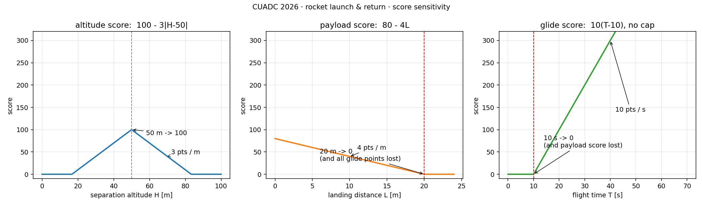

# 得分模型与策略

规则第 6 条的全部公式，加上我们自己算出来的敏感度。**这些数字决定备赛优先级。**

## 总分构成

```
S = S发射 + S高度 + S载荷 + S箭体 + S留空
  = 50   + 100  + 80   + 20  + 10·(T − 10)
      └────────── 封顶 250 ──────────┘   └── 不封顶 ──┘
```

前四项加起来最多 **250 分**，最后一项**没有上限**。
换句话说：只要飞行器还能在天上多待一秒，就多 10 分——比任何一项精度都值钱。



## 各分项与敏感度

### 高度分（每米 3 分）

`S高度 = 100 − 3·|H − 50|`

| 分离高度 H | 0 m 偏 | 5 m 偏 | 10 m 偏 | 20 m 偏 | 33 m 偏 |
|---|---|---|---|---|---|
| 得分 | 100 | 85 | 70 | 40 | 0 |

- 50 m 是**唯一最优点**，偏上偏下同样扣分
- 高度计精度到分米，但我们的**分离机构**精度才是主导
- H < 16.7 m 或 H > 83.3 m → 0 分

### 载荷回收分（每米 4 分）

`S载荷 = 80 − 4·L`，L 为飞行器到靶心距离

| 落点偏差 L | <0.1 m | 5 m | 10 m | 15 m | 20 m |
|---|---|---|---|---|---|
| 得分 | 80 | 60 | 40 | 20 | 0 |

- **20 m 是悬崖**：回收区半径 20 m，出圈直接 0 分
- 0 分不是只丢 80 分——见下面的连带效应

### 留空分（每秒 10 分，无上限）

`S留空 = 10·(T − 10)`，T 为整秒（舍尾）

| 留空 T | 10 s | 15 s | 20 s | 30 s | 45 s | 60 s |
|---|---|---|---|---|---|---|
| 得分 | 0 | 50 | 100 | 200 | 350 | 500 |

- **T 从火箭点火移动开始计**，到飞行器着陆静止停表——火箭上升段时间也算在内
- T < 10 s：留空分和载荷回收分**一起归零**

### 发射分与箭体回收分

固定分值，但都是"要么全有要么全无"：发射成功 50、箭体伞降进回收区 20。
发射失败还会直接终止该轮比赛。

## 三个必须记住的悬崖

| 悬崖 | 触发 | 损失 |
|---|---|---|
| 出回收区 | L ≥ 20 m | 80 分 + **全部留空分**（可能几百） |
| 留空不足 | T < 10 s | 留空分 + 载荷回收分 80 |
| 发射异常 | 锥角 > 90°、姿态不稳、抢发 | **整轮 0 分** |

第一条最致命：飞得好好的，落点偏 25 m，直接从 400 分掉到 150 分。

## 一分值多少

| 多拿到 1 分，需要… | 折算 |
|---|---|
| 着陆更准 0.25 m | 1 m = 4 分 |
| 分离高度更准 0.33 m | 1 m = 3 分 |
| 多滑翔 0.1 s | 1 s = 10 分 |

**结论：滑翔性能的边际收益是着陆精度的 25 倍。**
但前提是飞行器落在 40 m 圈内——圈内每秒 10 分，圈外一分没有。

## 策略推导

1. **先把 250 分的基础盘拿稳**
   发射 50 + 高度 100 + 箭体回收 20 = 170 分，这些不依赖飞行器性能。
   任何一项目标都是"不许失败"，不是"争取更高"。

2. **高度控制是性价比最高的精度项**
   50 m 分离要求分离机构一致性好；每改进 1 m 就是 3 分，且不依赖现场天气。

3. **飞行器设计围绕"留空"而不是"轻"**
   翼展 ≥ 300 mm 的下限已经给了足够的展弦比空间。
   在回收区内每多 1 s 抵 2.5 m 的落点误差，所以宁可牺牲一点操纵余量换滑翔效率。

4. **着陆策略：先保圈内，再谈精度**
   圈外清零的惩罚远大于圈内偏心的损失。
   控制手应当把"确保进圈"当作硬指标。

5. **火箭上升时间也是留空分**
   T 从点火开始计。上升段 8 s 相当于白送 80 分。
   但这不能靠"故意飞慢"来换——推力、质量、阻力是耦合的，且锥角约束还在。

## 常见亏分场景

| 场景 | 直接后果 | 根因 |
|---|---|---|
| 分离后伞绳缠住飞行器 | 7.1.2，载荷分 0 | 分离机构与伞舱布局冲突 |
| 飞机只飞 8 s 就落地 | 7.2.1，双双归零 | 滑翔性能不足或配平错误 |
| 高度计与飞机不同步 | 7.3.2，高度分 + 回收分归零 | 用一个舵机同时驱动两个锁 |
| 落点偏 25 m | 载荷分 0 且留空分清零 | 出圈 |
| 分离前飞机露出舱体 | 7.4.5，整轮 0 分 | 舱门设计间隙不足 |

## 校验用的规则原文

所有公式与阈值见 `../rules/CUADC-2026-rules.pdf` 第 44–45 页（规则 6.1–6.2）。
本页的敏感度表是按公式算的，若规则更新请同步改这张表和 `img/sensitivity.png`。
